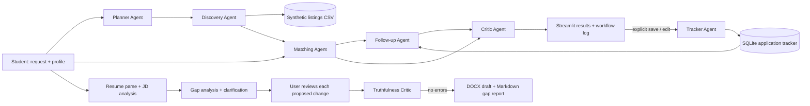

# Omnitrix — CA-3 Agentic AI PoC

Omnitrix is a student career-operations assistant for finding and managing internship opportunities. It demonstrates a small, inspectable agent workflow rather than a general-purpose chatbot. The PoC uses a deterministic Python implementation, Streamlit, pandas and SQLite; it needs no paid model or network access.

> **Demo data notice:** all 30 opportunities in `data/listings.csv` are synthetic. Their links use `example.com`; they are not real vacancies and are not verified employer information. The sample resume and job description are also fictional.

## Problem and domain

Students often search across multiple job boards, compare roles manually, miss closing dates, encounter duplicate or stale posts, and track applications in separate notes or spreadsheets. The chosen domain is **education and career operations**. The project focuses on reducing that coordination work while preserving student control over applications and resume claims.

## Proposed solution

The user describes what they want and enters a profile. Omnitrix creates a task plan, filters the local opportunity dataset, ranks candidates against the profile, checks the records, and returns reasoned matches plus date-based suggested actions. The student explicitly chooses whether to save or update an application. A separate resume workflow maps job requirements to evidence, asks for clarification, proposes reviewable edits, and blocks export when its truthfulness checks find an error.

### Agent responsibilities

| Role | Responsibility | Input → output |
|---|---|---|
| Planner | Routes a request to search, deadline review, or follow-up review; infers deterministic filters. | Request → ordered steps and filters |
| Discovery | Filters the local CSV without network access. | Listings + filters → candidates |
| Matching | Computes an explainable 0–100 fit score from documented weights. | Candidate + student profile → score, matched/missing skills, explanation |
| Follow-up | Suggests next steps from recorded deadlines and application dates. | Tracker records + candidates → dated suggestions |
| Critic | Checks required fields, date formats, closed/duplicate records, source status and matching explanation; validates action evidence. | Scored records/actions → passed, flagged or excluded items |
| Tracker | Writes to SQLite only when the user saves or edits an application. | Explicit UI action → persisted record |
| Resume agents | Parse the resume and job description, analyze evidence gaps, ask for confirmation, propose changes and check claims. | Resume + job description + user confirmations → reviewed draft and gap report |

## Architecture and data flow



**Decision points:** the Planner routes the task and turns urgency language into a deadline window. The Matcher ranks candidates. The Critic excludes malformed, closed or duplicate records, and flags records with unknown deadlines or unavailable sources. Follow-up suggestions require a recorded date. Resume export is blocked by truthfulness errors; no resume edit is submitted automatically.

## Running the PoC

```bash
pip install -r requirements.txt
streamlit run app.py
```

The app starts with a fixed as-of date (**15 October 2026**) for repeatable demonstrations. The sidebar can switch to the current date. Use **Seed demo data** to add sample tracker entries and **Clear tracker** to remove them. Both controls affect the local SQLite tracker only.

## Five-minute demonstration path

1. On Dashboard, describe the manual-search and follow-up problem.
2. In Find Opportunities, use the prefilled AI/NLP internship request and run the workflow. Point out retrieved, validated and excluded counts, then open a match's score explanation.
3. Open Agent Workflow to show the selected plan, agent hand-offs, validation summary and why records were excluded or flagged.
4. Save one role, then open My Applications or Deadlines & Follow-ups to show the human-controlled tracker and date-based suggestions.
5. In Resume Tailor, use the sample resume and job description; review evidence gaps and proposed changes, then explain that only confirmed facts can be added and export is gated by the truthfulness critic.

## Output validation and safeguards

- Strict ISO date parsing: invalid dates are excluded; missing dates are flagged rather than invented.
- Duplicate grouping and closed-record checks happen before results are shown as validated.
- Scores use fixed, documented weights: skills 50, role 20, location/work mode 15, opportunity type 10, deadline 5.
- Listings without a source URL are clearly marked unverified. All bundled listings are labeled synthetic.
- Application actions are suggestions, not employer status checks. SQLite changes require an explicit user action.
- Resume edits are proposed for review. The master resume is not modified; unsupported skills, claims, changed facts and invented metrics block export.

## Rubric coverage

| CA-3 requirement | Where it appears |
|---|---|
| Problem statement and domain justification | Problem and domain section above; app overview |
| Existing challenge and proposed solution | Problem and Proposed solution sections |
| Agent roles and orchestration | Agent responsibilities table; Agent Workflow tab; `opportunityos/orchestrator.py` |
| Architecture diagram with data flow and decisions | Mermaid architecture above |
| Working Streamlit PoC with dummy data | `app.py`; `data/listings.csv` |
| Validation, results, limitations and future scope | Validation section, UI validation panel, and Limits below |
| PPT | `presentation/OpportunityOS_CA3.pptx` covers the problem, agent architecture, UI workflow, output validation, limitations and next steps. |
| Project report | `report/Omnitrix_CA3_Project_Report.docx` documents the problem, architecture, implementation, validation, demo path, limitations and rubric coverage. |

## Limitations and future scope

The demo dataset is static and synthetic. Skill matching is keyword-based, the Planner uses transparent keyword rules, and scores are heuristic rather than predictive. There are no live job-board integrations, employer verification, notifications, or application submissions. Resume parsing depends on document structure and the truthfulness critic is a useful guardrail, not a guarantee that every claim is accurate.

Possible next steps include connecting an approved opportunity feed, adding source freshness timestamps and human review, evaluating ranking quality with student feedback, supporting configurable scoring weights, and adding opt-in reminders. Any live-source version should preserve source attribution and validation steps.

## Project map

- `app.py` — page orchestration, session state, forms, caching, and workflows
- `opportunityos/ui_components.py` — shared theme, cards, badges, and action display components
- `.streamlit/config.toml` — light theme palette and typography
- `opportunityos/orchestrator.py` — ordered workflow and hand-offs
- `opportunityos/agents/` — planner, discovery, matching, follow-up, critic and tracker
- `opportunityos/resume/` — parsing, gap analysis, clarification, tailoring, truth checks and exports
- `data/` — synthetic listings and fictional sample documents
- `tools/make_data.py` — reproducible synthetic listing generator
